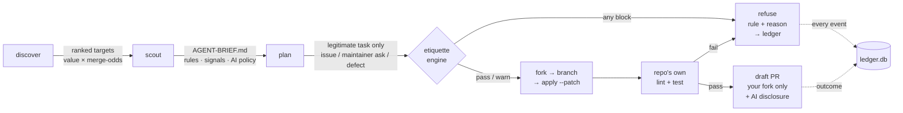

# contribot

**An agent that onboards onto any OSS repo, understands it, and makes meaningful
contributions — with hard etiquette limits so it can never act like a bot.**

GitHub is drowning in AI slop PRs. Maintainers auto-close them, and some
projects ban AI contributions outright. contribot's differentiator: **the
guardrails ARE the product.** Contribution etiquette is enforced in code, not
prompted. The positioning is respectful contribution — never "AI PRs at scale."



## Install

```bash
npm install && npm run build
npm link        # puts `contribot` on PATH
```

Node 20+. Auth: `GITHUB_TOKEN`/`GH_TOKEN` env, or `gh auth login` (contribot
reuses `gh auth token`). Read-only commands work unauthenticated at lower rate
limits.

## Commands

```
contribot discover [--lang ts]    # search repos ranked by value × merge-odds, AI-bans flagged
contribot scout <repo>            # read-only: full AGENT-BRIEF.md to stdout (or --out file)
contribot plan <repo> --issue 42  # pick a contribution, produce a plan (no writes to GitHub)
contribot pr <repo> --issue 42    # brief → checks → fork → branch → patch → repo CI → draft PR
contribot ledger [--no-sync]      # all activity: PRs opened/merged/rejected, per-repo (syncs outcomes)
contribot limits                  # show current etiquette limits + config
```

Typical session:

```bash
contribot discover --lang typescript        # where will a PR actually land?
contribot scout excalidraw/excalidraw       # understand the repo + its rules
contribot plan excalidraw/excalidraw        # pick a legitimate task
# …make the change yourself (or with your own agent) → fix.patch…
contribot pr excalidraw/excalidraw --patch fix.patch --issue 123
```

## The etiquette engine

Hard-coded limits, configurable **down** (stricter) only via
`~/.contribot/config.json`:

| Check | Default | Behavior |
|---|---|---|
| max open PRs per repo | 1 | refuse if you already have an open PR there |
| max PRs per day, global | 2 | refuse above |
| per-repo cooldown after closed/rejected PR | 14d | refuse |
| AI-banned detection | block | CONTRIBUTING bans AI → hard stop, **no override** |
| linked issue | block | PRs must reference an open issue (or `--trivial`) |
| diff size cap | 400 lines | larger → requires `--allow-large` |
| issue legitimacy | warn | only `good first`/`help wanted`/`bug`/`docs`/`tests` labels, or >30d old |
| maintainer-requested | boost | maintainer help-wanted comments rank first |
| CI parity | block | repo's own lint/test must pass locally before PR |
| disclosure | enforce | PR body carries a non-removable AI-assistance line |
| fork safety | enforce | never push upstream, never force-push, never touch others' branches |

**Why this strict?** Maintainers judge contributors by footprint. A trail of
simultaneous open PRs is the bot signature that gets accounts reported and gets
repos to adopt blanket AI bans. One open PR per repo means you only ever ask a
maintainer to review your *best* shot; two a day globally keeps a bad streak
from becoming a reputation stain. The defaults can't be raised without opting
into unsafe mode — that's the trust contract, not an inconvenience. Per-check `--force-*` flags
exist for exceptional humans, and every override is logged loudly to the
ledger: the accountability trail is a feature.

**Modifying limits at your own risk.** `~/.contribot/config.json` accepts
`"allowUnsafeLimits": true`, which unlocks raising the *numeric* caps
(`maxOpenPrsPerRepo`, `maxPrsPerDay`, `cooldownDays`, `diffSizeCap`,
`issueAgeDays`). Three things can never be loosened because they're ethics, not
limits: AI-ban hard stop, the disclosure line, fork safety. Every relaxed limit
is printed as `[limit relaxed — unsafe mode]` in check output and logged to the
ledger on every `pr` run — your reputation, your call, on the record.

## What `scout` produces

`AGENT-BRIEF.md`:

- **project map** — languages, layout, entry points, test setup, CI commands
  parsed out of `.github/workflows`
- **contribution rules** — extracted from CONTRIBUTING.md / CODE_OF_CONDUCT /
  PR & issue templates / DCO-CLA requirements into a machine-checkable checklist
- **maintainer signals** — external-PR merge rate, median time-to-first-review,
  `good first issue` / `help wanted` counts
- **AI-policy verdict** — welcomed / banned / unmentioned / ambiguous, with
  evidence lines. Banned → hard stop.
- **conventions** — conventional-commit ratio, sign-off requirements, lint config

## Meaningful improvements only

`plan`/`pr` must justify the change. **Accepted:** issues labeled
good-first / help-wanted / bug / docs / tests · **issues filed by a
maintainer** (highest merge-odds signal — they wrote it because they want it
fixed) · issues with a maintainer comment requesting a fix · a detected defect
with evidence (e.g. a dead doc link). **Rejected outright:** cosmetic refactors, "improvements" with no
issue/defect, dependency bumps a bot already owns (dependabot/renovate detected
→ skipped), reformatting, comment churn, README badges.

`pr` does not invent diffs — you (or your outer agent) supply `--patch
<diff-file>`; contribot does everything around it: preflight checks → fork →
branch → apply patch → size re-check → commit (sign-off honored,
conventional-commit style detected) → run the repo's own checks → push to
**your fork only** → **draft** PR with an honest body (problem / change /
verification / AI disclosure).

## Ledger

Every action lands in `~/.contribot/ledger.db`: scouts, plans, PRs opened,
outcomes, cooldowns, refusals, overrides. `contribot ledger` first syncs the
outcome of every still-open PR from GitHub (skip with `--no-sync`), then shows
history and per-repo reputation ("2 merged, 1 closed"). Closed-unmerged PRs
count as rejections: rejection rate >50% (min 3 resolved) → the tool warns you
that you're generating slop.

## Library

```ts
import { createAgent } from "contribot";
const agent = createAgent();
const { markdown } = await agent.scout("expressjs/express");
const plan = await agent.plan("vercel/ms", { issue: 123 });
const res = await agent.pr("owner/repo", { issue: 123, patch: "fix.patch" });
```

## Non-goals (v1)

No auto-commenting, no issue triage on others' repos, no mass operations. No
LLM requirement (the checks layer is deterministic; an optional LLM hook for
prose briefs is future work). No GitLab/Bitbucket, no private repos. No MCP
server yet (`src/mcp/README.md`).

## Tests

`npx vitest run` — covers the brief extractor, every etiquette rule, the
dependabot rejection, discover scoring (AI-ban sinks), ledger accounting, and
the no-suitable-task exit.

## License

MIT
